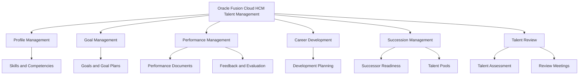
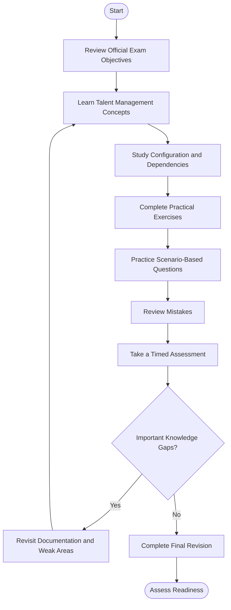
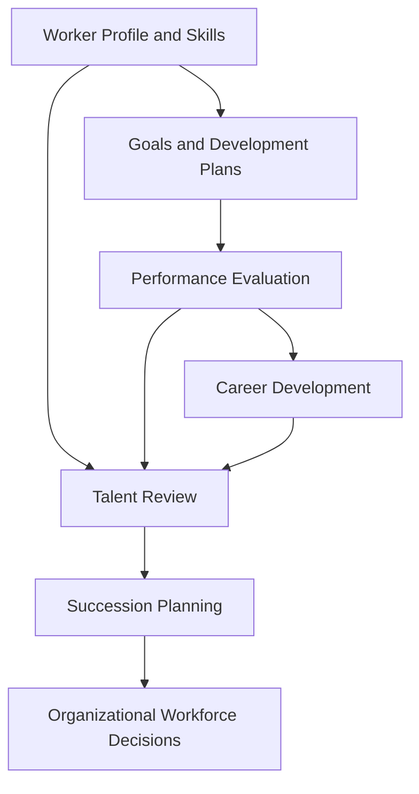
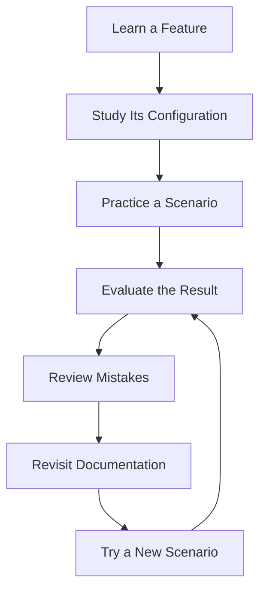
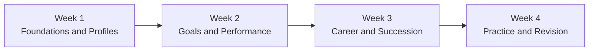

# Oracle Talent Management Cloud 2026 Implementation Professional (1Z0-1052-26)

A practical study guide for the **Oracle Talent Management Cloud 2026 Implementation Professional** certification. This repository helps learners organize their preparation around Oracle Fusion Cloud HCM Talent Management, goal management, performance management, profile management, succession planning, talent reviews, and implementation workflows.

The objective is to build a clear understanding of how Oracle Talent Management supports employee development, performance evaluation, career planning, and workforce succession.

- **Exam code:** `1Z0-1052-26`
- **Certification provider:** Oracle
- **Product area:** Oracle Fusion Cloud HCM — Talent Management
- **Official learning path:** [Become a Certified Talent Management Implementer](https://learn.oracle.com/ols/learning-path/46602/47559)
- **Additional preparation resource:** [CertsGate — 1Z0-1052-26](https://certsgate.com/exams/oracle/1z0-1052-26)

## Table of Contents

- [About the Certification](#about-the-certification)
- [Who Should Prepare for This Exam?](#who-should-prepare-for-this-exam)
- [Exam Information](#exam-information)
- [Skills and Knowledge Areas](#skills-and-knowledge-areas)
- [Official Exam Objectives](#official-exam-objectives)
- [Oracle Talent Management Functional Map](#oracle-talent-management-functional-map)
- [Certification Preparation Flowchart](#certification-preparation-flowchart)
- [Talent Management Architecture](#talent-management-architecture)
- [Study and Revision Cycle](#study-and-revision-cycle)
- [Step-by-Step Preparation Guide](#step-by-step-preparation-guide)
- [Recommended Study Schedule](#recommended-study-schedule)
- [Practice Questions and Mock Tests](#practice-questions-and-mock-tests)
- [Hands-On Exercises](#hands-on-exercises)
- [Common Preparation Mistakes](#common-preparation-mistakes)
- [Career Relevance](#career-relevance)
- [Frequently Asked Questions](#frequently-asked-questions)
- [Official and Additional Learning Resources](#official-and-additional-learning-resources)
- [About CertsGate](#about-certsgate)
- [Disclaimer](#disclaimer)

---

## About the Certification

The Oracle Talent Management Cloud 2026 Implementation Professional certification is intended for professionals developing implementation knowledge of Oracle Fusion Cloud HCM Talent Management.

Talent Management helps organizations establish goals, support ongoing employee development, evaluate performance, identify career opportunities, and plan for future workforce needs. These processes are connected: employee goals can inform performance discussions, performance information can support development decisions, and talent reviews can help organizations identify potential successors for important roles.

Implementation requires understanding how the relevant features are configured and how they support business requirements. A learner should be able to explain the purpose of a feature, recognize its relationship to other Talent Management processes, and investigate configuration issues systematically.

Oracle's official learning path provides a useful starting point for the certification:

[Become a Certified Talent Management Implementer — Oracle University](https://learn.oracle.com/ols/learning-path/46602/47559)

## Who Should Prepare for This Exam?

This certification may be useful for:

- Oracle Fusion Cloud HCM functional consultants.
- Talent Management implementation specialists.
- HRIS analysts and HR technology professionals.
- Human resources professionals working with performance and development systems.
- Consultants supporting employee goals, succession planning, and talent reviews.
- IT professionals building a career in Oracle HCM implementation.

Previous experience with HR processes, performance evaluations, employee development, or enterprise application configuration can make the concepts easier to understand.

Candidates new to Oracle HCM should begin with the product's terminology and functional overview before moving into configuration details and scenario-based practice.

## Exam Information

| Item | Information |
|---|---|
| Certification | Oracle Talent Management Cloud 2026 Implementation Professional |
| Exam code | 1Z0-1052-26 |
| Provider | Oracle |
| Product family | Oracle Fusion Cloud HCM |
| Functional focus | Talent Management |
| Official preparation path | Oracle University |
| Assessment approach | Oracle lists this certification among its hands-on performance-based exams |
| Supplementary preparation | [CertsGate exam resource](https://certsgate.com/exams/oracle/1z0-1052-26) |

Oracle's hands-on performance exam documentation explicitly includes `1Z0-1052-26` in its list of relevant certifications.

See: [Oracle Hands-on Performance Exams FAQ](https://docs.oracle.com/en/education/customer-success/digital-learning-kit/ml-cert-faq/topics/HandsOnPerformanceExams.html).

Exam duration, question count, passing score, delivery options, and registration requirements should be verified against the current official listing for your exam language and region. Do not assume that details published for a localized version necessarily apply to every version.

## Skills and Knowledge Areas

A useful preparation plan should cover the major functional areas of Talent Management and the relationships among them.

| Knowledge area | What to study |
|---|---|
| Profile Management | Worker profiles, profile content, competencies, and skills-related information |
| Goal Management | Goal creation, goal plans, goal libraries, eligibility, and goal alignment |
| Performance Management | Performance documents, evaluation processes, feedback, and approvals |
| Career Development | Development goals, career interests, and employee growth planning |
| Succession Management | Succession plans, candidate readiness, and workforce continuity |
| Talent Pools | Grouping and reviewing talent according to organizational requirements |
| Talent Review | Talent review processes, meeting preparation, and assessment discussions |
| Implementation Configuration | Setup dependencies, configuration options, testing, and validation |
| Security and Administration | Appropriate roles, access, and administrative responsibilities |
| Product Updates | Relevant current-release functionality and changes documented by Oracle |

This is an independent study overview, not an official exam blueprint. Confirm the precise objectives in the current Oracle learning and certification materials before allocating study time.

## Official Exam Objectives

Start by reviewing the official Oracle learning path:

[Oracle Talent Management Implementation Certification Learning Path](https://learn.oracle.com/ols/learning-path/46602/47559)

Oracle lists courses and learning activities associated with Profile Management, Redwood Functional Setup Manager, Goal and Performance Management, Succession Management and Talent Review, Career Development, product updates, and applied implementation learning.

Use the learning path to organize your preparation, then consult the relevant product documentation for configuration details.

### Study checklist

- [ ] Understand the purpose of Oracle Fusion Cloud Talent Management.
- [ ] Review Profile Management and related profile concepts.
- [ ] Study goal creation, goal libraries, and goal plans.
- [ ] Understand performance document configuration and evaluation workflows.
- [ ] Review feedback, participant involvement, and approval processes where applicable.
- [ ] Study Career Development functionality.
- [ ] Understand succession plans and talent pools.
- [ ] Review talent review processes and talent assessment concepts.
- [ ] Understand relevant setup dependencies and configuration validation.
- [ ] Investigate security and access requirements.
- [ ] Review relevant release-specific features documented by Oracle.
- [ ] Practice explaining how configuration choices support business requirements.

The checklist is a preparation aid. It should not be interpreted as a complete or officially weighted exam objective list.

## Oracle Talent Management Functional Map

The following conceptual map shows how the major learning areas relate to one another. It is an independent study model rather than an official Oracle exam diagram.

The value of this model is that it encourages you to study connected processes instead of treating each feature as an isolated topic.

For example, career development and profile information may support employee growth discussions, while succession planning and talent reviews support longer-term workforce decisions.

## Certification Preparation Flowchart

Use this workflow to move from initial learning to readiness assessment.

A practice result is useful only when it informs your next step. If a question exposes a misunderstanding about goal plans or performance documents, revisit the relevant concept before attempting more questions on the same topic.

## Talent Management Architecture

This conceptual diagram illustrates how several Talent Management processes can contribute to employee development and organizational workforce planning. It is not an official Oracle system architecture.

When studying this model, consider the following questions:

- How can employee goals support performance discussions?
- How can profile information help inform development planning?
- What is the difference between an individual development plan and a succession plan?
- How might talent review support decisions about future leadership needs?
- What configuration and access requirements should be validated before a process is used?

These questions are intended to build functional understanding. The exact data relationships and system behavior should be verified in Oracle documentation.

## Study and Revision Cycle

Talent Management preparation benefits from repeated learning, practical application, and review.

For example, if you struggle to distinguish goal management from performance evaluation, review the purpose of each feature and examine how the processes are configured. Then use a new business scenario to test your understanding.

Avoid repeating the same questions until you remember the answers without understanding the underlying concepts.

## Step-by-Step Preparation Guide

### Step 1: Build a Foundation

Start with the official Oracle learning path and the Talent Management product documentation.

Become familiar with the main features and their purposes. Understand the difference between managing an employee's profile, setting goals, evaluating performance, planning career development, and identifying successors.

### Step 2: Study Profile Management

Learn how profile information supports an understanding of employee qualifications, skills, and competencies.

Review relevant profile configuration and understand how organizations maintain information that supports talent-related processes.

When studying skills-related functionality, distinguish general product concepts from release-specific features and verify current behavior in Oracle documentation.

### Step 3: Learn Goal Management

Study how goals are created and maintained, how goal libraries support reusable goal definitions, and how goal plans organize goal-related activities.

Use realistic business scenarios. For example, consider how an organization might communicate departmental priorities to employees and support individual goal setting.

Focus on the business requirement, relevant configuration, and expected result.

### Step 4: Understand Performance Management

Review performance document concepts and the processes used to collect and evaluate performance information.

Study the relationship between participants, feedback, evaluations, and approvals where these are relevant to the documented workflow.

Practice explaining how an administrator would investigate an issue involving a performance document or an unexpected workflow result.

### Step 5: Study Career Development

Understand how development planning can help employees identify skills to build and career interests to pursue.

Compare development activities with performance evaluation and succession planning. They can support related organizational goals, but they serve different purposes.

### Step 6: Study Succession Management and Talent Review

Review succession planning, talent pools, candidate readiness, and talent review concepts.

Consider a scenario in which an organization needs to identify possible successors for a critical role. Think about how the organization would evaluate candidates, review relevant information, and document succession decisions.

Study the relevant configuration and security considerations using the official implementation material.

### Step 7: Practice Configuration and Troubleshooting

Where possible, use an authorized Oracle training environment to explore configuration tasks and observe their results.

Follow the documented workflow, identify prerequisites, and verify the outcome after each exercise.

If you do not have access to a practice environment, use official documentation and structured scenario exercises to trace the expected configuration process.

### Step 8: Assess Readiness

Complete practice questions only after reviewing the related concepts.

Record incorrect and uncertain answers, map them to the relevant study topics, and revisit the official documentation. Finish with a timed assessment that reflects the current requirements and conditions of your registered exam.

## Recommended Study Schedule

The following four-week plan is an independent recommendation, not an official Oracle preparation requirement.

| Period | Main focus | Suggested outcome |
|---|---|---|
| Week 1 | Product overview, Profile Management, skills, and competencies | Understand the core terminology |
| Week 2 | Goal Management and Performance Management | Explain the main configuration concepts |
| Week 3 | Career Development, Succession Management, and Talent Review | Understand the related workforce processes |
| Week 4 | Practical exercises, practice questions, and weak-area revision | Evaluate readiness and close knowledge gaps |

Adjust the schedule according to your experience, available study time, and familiarity with Oracle Fusion Cloud HCM.

If you already work with Talent Management, prioritize unfamiliar configuration tasks and release-specific features. If you are new to the platform, spend additional time learning the product's terminology and functional relationships.

## Practice Questions and Mock Tests

Practice questions can help identify gaps in your knowledge, but they should reinforce learning rather than replace it.

The [CertsGate 1Z0-1052-26 preparation page](https://certsgate.com/exams/oracle/1z0-1052-26) is a supplementary resource to explore alongside Oracle's official materials.

Use this review method:

1. Read the scenario carefully and identify the business requirement.
2. Determine which Talent Management feature is relevant.
3. Select an answer based on your understanding of the documented functionality.
4. Review the explanation and examine why alternative approaches may not fit.
5. Map any mistake to the relevant objective or learning topic.
6. Revisit official documentation and try a different scenario.

### Original Conceptual Practice Exercises

The following questions are independent educational exercises, not actual or official Oracle exam questions.

**Question 1: Goal Management**

An organization wants to organize employee goals using reusable goal definitions. Which Talent Management area should you investigate first?

A. Goal Management and the goal library.

B. Network routing configuration.

C. Database backup scheduling.

D. Unrelated infrastructure monitoring.

**Learning focus:** The purpose of goal libraries and goal-related configuration.

**Question 2: Career Development**

An employee wants to identify development activities that support future career interests. Which functional area is most directly relevant?

A. Career Development.

B. Succession approval alone.

C. Enterprise network administration.

D. External identity provisioning alone.

**Learning focus:** Career planning and employee development.

**Question 3: Succession Management**

An organization wants to identify possible successors for a critical position and review their readiness. Which area should the implementation consultant investigate?

A. Succession Management.

B. Goal library maintenance alone.

C. Browser cache management.

D. Unrelated payroll reporting.

**Learning focus:** Succession plans, candidate readiness, and workforce continuity.

**Question 4: Performance Management**

An administrator needs to investigate an unexpected result in a performance evaluation workflow. What is the best initial approach?

A. Change unrelated configuration without investigation.

B. Review the relevant performance document setup, workflow, and documented requirements.

C. Grant every user unrestricted access.

D. Delete all existing performance records.

**Learning focus:** Configuration validation and systematic troubleshooting.

These exercises cover general functional reasoning. Always confirm product-specific behavior through Oracle's current documentation and training.

## Hands-On Exercises

Practical exercises help turn product terminology into implementation knowledge.

Use an authorized training environment when available. Do not make experimental changes to production systems or access employee information without permission.

| Exercise | Learning objective |
|---|---|
| Explore Profile Management | Understand profile concepts and related configuration |
| Review goal libraries and goal plans | Understand how goal definitions support goal management |
| Trace a performance workflow | Identify relevant configuration and process stages |
| Review development planning | Understand how employee development supports career goals |
| Examine succession planning | Learn about succession plans and candidate readiness |
| Explore talent review concepts | Understand how organizations assess talent |
| Investigate a configuration issue | Develop a systematic troubleshooting approach |
| Document a setup workflow | Explain prerequisites, actions, and validation |

For every exercise, record the business requirement, relevant feature, configuration prerequisites, expected behavior, and validation method.

If a training environment is unavailable, use Oracle's learning path and product documentation to trace each workflow conceptually.

## Common Preparation Mistakes

### Memorizing Questions Instead of Understanding Features

Remembering an answer does not demonstrate that you can solve a new implementation scenario. Learn the reasoning behind each answer.

### Treating Related Processes as Identical

Goal Management, Performance Management, Career Development, Succession Management, and Talent Review can support related HR objectives, but each serves a distinct functional purpose.

### Ignoring Configuration Dependencies

A feature may depend on other setup decisions or administrative requirements. Understand the documented prerequisites instead of learning each task in isolation.

### Skipping Practical Exercises

Where access is available, perform configuration tasks and verify their outcomes. Practical experience makes it easier to connect documentation with implementation behavior.

### Relying Only on Third-Party Practice Material

Supplementary questions can help identify gaps, but they do not replace official objectives, Oracle documentation, or hands-on learning.

### Neglecting Incorrect Answers

Keep a record of mistakes and the concepts responsible for them. Revisit weak areas before increasing the volume of practice questions.

### Assuming One Assessment Proves Readiness

Consider your coverage of official objectives, ability to explain features, practical understanding, and performance across different scenarios.

## Career Relevance

Oracle Talent Management knowledge can be relevant to professionals working with HR technology, employee development, performance processes, and enterprise HCM implementation.

Potentially related roles include:

- Oracle HCM functional consultant.
- Talent Management implementation consultant.
- HRIS analyst.
- HR technology specialist.
- Career development systems analyst.
- HCM application support consultant.

The actual requirements for these roles vary by employer, seniority, and project scope.

Certification preparation can help organize product knowledge, but it does not replace practical implementation experience, communication skills, or an understanding of HR business requirements.

## Frequently Asked Questions

### What is the Oracle 1Z0-1052-26 certification?

It is the Oracle Talent Management Cloud 2026 Implementation Professional certification, focused on implementation knowledge for Oracle Fusion Cloud HCM Talent Management.

### Where should I start preparing?

Start with the [official Oracle Talent Management learning path](https://learn.oracle.com/ols/learning-path/46602/47559). Use the associated courses and product documentation to organize your study around the relevant functional areas.

### Which subjects should I study?

Begin with Profile Management, Goal Management, Performance Management, Career Development, Succession Management, and Talent Review. Confirm the complete current exam objectives through Oracle's official certification resources.

### Are practice questions enough?

No single resource should be your entire preparation strategy. Combine official learning materials, product documentation, practical exercises where possible, practice questions, and review of mistakes.

### How long should I prepare?

The required time depends on your Oracle HCM experience, familiarity with HR processes, access to a practice environment, and current knowledge gaps. The four-week schedule in this repository is a suggested framework rather than an official requirement.

### Where can I find additional preparation material?

Start with [Oracle University](https://learn.oracle.com/ols/learning-path/46602/47559), consult the [Oracle Talent Management documentation](https://docs.oracle.com/en/cloud/saas/talent-management/), and explore the supplementary [CertsGate 1Z0-1052-26 resource](https://certsgate.com/exams/oracle/1z0-1052-26).

### Does this study guide guarantee a passing result?

No. It is an independent educational resource designed to support structured preparation. Exam results depend on your understanding, practical skills, and performance under the applicable assessment conditions.

## Official and Additional Learning Resources

Use Oracle's resources as the foundation of your study plan.

| Resource | Purpose |
|---|---|
| [Oracle Talent Management learning path](https://learn.oracle.com/ols/learning-path/46602/47559) | Review official courses, learning activities, and certification preparation |
| [Oracle Talent Management documentation](https://docs.oracle.com/en/cloud/saas/talent-management/) | Study product functionality, implementation, administration, and configuration |
| [Oracle hands-on performance exam FAQ](https://docs.oracle.com/en/education/customer-success/digital-learning-kit/ml-cert-faq/topics/HandsOnPerformanceExams.html) | Understand Oracle's hands-on performance-based assessment approach |
| [Oracle certification resources](https://www.oracle.com/education/certification/) | Review Oracle certification information and related resources |
| [CertsGate 1Z0-1052-26 page](https://certsgate.com/exams/oracle/1z0-1052-26) | Explore supplementary certification preparation material |
| [CertsGate](https://certsgate.com/) | Browse additional IT certification study resources |

Oracle's Talent Management documentation also includes product update information. Review release-specific material when it is relevant to the objectives and product version associated with your certification.

## About CertsGate

[CertsGate.com](https://certsgate.com/) provides supplementary IT certification preparation resources for learners exploring professional certification paths.

The dedicated [Oracle Talent Management Cloud 2026 preparation page](https://certsgate.com/exams/oracle/1z0-1052-26) is a starting point for exploring material related to this exam.

Use third-party resources to reinforce concepts, check your understanding, and identify topics that need further study. Oracle's official documentation and learning resources should remain the foundation of your preparation.
